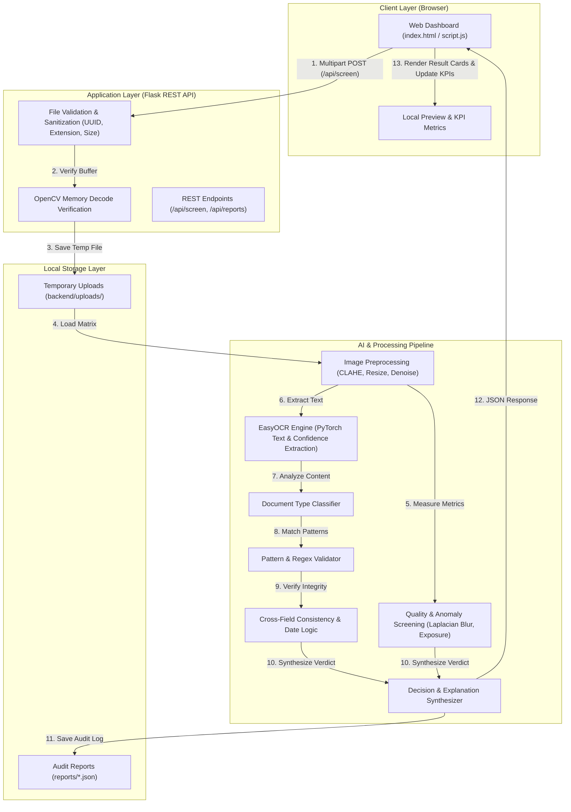

# AI-Based Fake Identity & Document Screening System

> **A software-only, privacy-preserving, preliminary document inspection and integrity screening platform for academic and verification workflows.**

---

## 1. Project Title
**AI-Based Fake Identity & Document Screening System**  
*(Preliminary Inspection & Computer Vision Verification Assistant)*

---

## 2. Problem Statement
Forged, altered, and synthetically generated identity documents pose significant risks to academic admissions, human resource onboarding, and administrative compliance. Manual physical inspection is slow, inconsistent, and prone to human oversight. Furthermore, commercial verification services frequently depend on third-party cloud infrastructure, raising severe data privacy concerns regarding sensitive Personally Identifiable Information (PII).

Organizations need an automated, local, and explainable **preliminary screening mechanism** to rapidly triage submitted identity proofs, flag structural and visual anomalies, and highlight suspicious documents before manual review.

---

## 3. Objective
The primary objective of this project is to develop an offline-capable, lightweight, preliminary screening software that:
- Ingests digital images of identity documents (Aadhaar, PAN, Passport, Driving Licence, Voter ID, Student/Employee IDs).
- Evaluates image quality (blurriness, exposure, resolution, aspect ratio anomalies).
- Preprocesses images using contrast-limited adaptive histogram equalization (CLAHE) and intelligent scaling.
- Extracts printed text via optical character recognition (OCR) and records per-word confidence metrics.
- Classifies document types and extracts critical identity fields (Name, Identifier, DOB, Gender, Expiry).
- Applies deterministic pattern validation (regex) and cross-field consistency checks.
- Produces an explainable verdict (`Normal` vs `Needs Review`) with specific rationale and full legal disclaimers.
- Retains local audit reports in JSON format without sending data to external cloud servers.

> **CRITICAL DISCLAIMER:**  
> This system is strictly a **preliminary computer vision and heuristic screening tool**. It does **NOT** provide legal or definitive proof of whether a document is authentic, genuine, or fraudulent. Final validation requires authorized database verification (e.g., UIDAI, NSDL, DigiLocker).

---

## 4. Key Features

- **Document Classification Engine:** Automatically identifies Aadhaar Card, PAN Card, Passport, Driving Licence, Voter ID, Student ID, Employee ID, or flags Unknown formats using keyword heuristics.
- **Advanced Computer Vision Preprocessing:** Leverages OpenCV for grayscale conversion, adaptive resizing, bilateral noise reduction, and CLAHE to maximize OCR readability on varied document captures.
- **Confidence-Scored OCR:** Powered by EasyOCR with PyTorch, returning extracted text blocks along with bounding coordinates and mean confidence ratings.
- **Pattern & Format Validation:** Deterministic regular expression validation for standard Indian identity formats:
  - **PAN:** 10-character alphanumeric `[A-Z]{5}[0-9]{4}[A-Z]{1}`.
  - **Aadhaar:** 12-digit numeric representation with automatic privacy masking (`XXXX-XXXX-1234`).
  - **Passport:** Standard letter prefix followed by 7 digits.
  - **Driving Licence:** State code prefix with numeric sequence.
  - **Voter ID (EPIC):** Standard 3-letter prefix with 7 digits.
- **Heuristic Integrity & Consistency Checks:**
  - Presence of mandatory fields (Name, Identifier, DOB).
  - Cross-field alignment between detected document category and identified credentials.
  - Date of Birth reasonableness testing (century bounds, future dates, valid age range).
  - Character distribution and text noise validation.
- **Image Anomaly & Quality Analysis:**
  - Blur score calculation using the variance of the Laplacian filter.
  - Brightness/luminance analysis to flag severe under-exposure or over-exposure.
  - Dimension and resolution checks.
  - Aspect ratio anomaly screening to flag stretched or non-standard card crops.
- **Explainable Diagnostic Verdicts:**
  - Categorizes records into **`Normal`** (Passed preliminary heuristics) or **`Needs Review`** (Failed one or more quality, format, or consistency checks).
  - Lists granular, transparent **Review Reasons** explaining exactly why manual inspection is requested.
- **Local Audit Reporting:** Automatically serializes full screening results to timestamped JSON reports in a dedicated `reports/` folder.
- **Interactive Web Dashboard:** Modern, responsive dark-themed frontend with real-time KPI metrics, drag-and-drop file upload, processing progress feedback, diagnostic result cards, and inspection history with single-click deletion.
- **Operator Authentication Portal:** Secure Inspector ID and Password sign-in gate preventing unauthenticated dashboard access, complete with session storage, password visibility toggle, quick-fill demo credentials, and instant sign-out.
- **Security Hardened:** UUID file sanitization, strict extension allowlists (`.jpg`, `.jpeg`, `.png`), 16 MB payload limit, OpenCV decode verification before persistence, path traversal protection, and error handling without stack trace leakage.

---

## 5. System Architecture



---

## 6. Technology Stack

| Layer | Component | Technologies |
| :--- | :--- | :--- |
| **Frontend** | User Interface | HTML5, CSS3 (Modern Dark/Crimson Theme, Grid/Flexbox), Vanilla JavaScript (ES6+, Fetch API) |
| **Backend** | REST API Server | Python 3.10+, Flask 3.1, Flask-CORS, Werkzeug |
| **AI / OCR** | Text Recognition | EasyOCR 1.7+, PyTorch 2.6+ (CPU execution) |
| **Computer Vision** | Image Processing | OpenCV (`opencv-python-headless` 4.11+), NumPy 2.2+ |
| **Data Persistence** | Audit Log Store | Local JSON Document Store (`reports/*.json`) |

---

## 7. Project Structure

```text
AI-Fake-Identity-Screening/
├── backend/
│   ├── app.py                       # Flask REST server, route endpoints & security handlers
│   ├── services/
│   │   ├── ocr.py                   # OpenCV image preprocessing & EasyOCR extraction service
│   │   └── document_analysis.py     # Document classification, regex, consistency & verdict logic
│   └── uploads/                     # Sanitized uploaded images (cleaned/persisted locally)
├── frontend/
│   ├── index.html                   # Dashboard UI structure & semantic markup
│   ├── style.css                    # Professional dark theme styling, badges & responsive layout
│   └── script.js                    # Client-side API integration, drag-and-drop, UI state manager
├── reports/                         # Generated JSON audit screening reports
├── requirements.txt                 # Backend Python package dependencies
└── README.md                        # Complete project documentation & setup guide
```

---

## 8. Installation Steps

### Prerequisites
- Python 3.10, 3.11, 3.12, 3.13, or 3.14 installed on your workstation.
- Modern web browser (Google Chrome, Mozilla Firefox, Microsoft Edge).
- Git (optional, for cloning).

### Step 1: Clone or Navigate to Project Directory
```powershell
cd D:\AI-Fake-Identity-Screening
```

### Step 2: Create a Python Virtual Environment
```powershell
python -m venv venv
```

### Step 3: Activate the Virtual Environment
- **Windows PowerShell:**
  ```powershell
  .\venv\Scripts\Activate.ps1
  ```
  *(If script execution is disabled on PowerShell, run: `Set-ExecutionPolicy -Scope Process -ExecutionPolicy Bypass`)*
- **Windows Command Prompt (cmd.exe):**
  ```cmd
  venv\Scripts\activate.bat
  ```

### Step 4: Install Dependencies
```powershell
pip install -r requirements.txt
```

*(Note: Installing EasyOCR and PyTorch may take a couple of minutes depending on network speed. The project is configured for CPU inference, requiring no GPU).*

---

## 9. How to Run Backend

1. Ensure your virtual environment is active (`(venv)` appears in the prompt).
2. Execute the Flask application:
   ```powershell
   python backend\app.py
   ```
3. The server will start and bind to `http://127.0.0.1:5000`:
   ```text
   * Running on http://127.0.0.1:5000 (Press CTRL+C to quit)
   ```
4. Verify the backend health endpoint by opening a browser or running:
   ```powershell
   curl http://127.0.0.1:5000/api/health
   ```
   **Expected Response:**
   ```json
   {"status": "healthy", "service": "AI-Fake-Identity-Screening"}
   ```

---

## 10. How to Run Frontend

The frontend is built with pure web technologies and requires no bundler or Node.js environment.

### Option A: Direct Browser Access (Simplest)
Double-click `frontend\index.html` or open it directly in your browser:
```text
file:///D:/AI-Fake-Identity-Screening/frontend/index.html
```

### Option B: Local HTTP Server (Recommended)
In a separate terminal window, serve the frontend folder via Python's built-in HTTP server:
```powershell
python -m http.server 8000 --directory frontend
```
Then navigate to:
```text
http://127.0.0.1:8000
```

### Inspector Sign-In Credentials
Before the dashboard unlocks, enter your authorized operator credentials:
- **Operator / Inspector ID:** `admin` (or `officer`)
- **Security Password:** `admin123` (or `screen2026`)
*(Or click the **"Auto-Fill"** button on the sign-in card for one-click access)*

---

## 11. API Documentation

### 1. Health Check
- **Endpoint:** `GET /api/health`
- **Description:** Verifies service availability.
- **Response `200 OK`:**
  ```json
  {
    "status": "healthy",
    "service": "AI-Fake-Identity-Screening"
  }
  ```

---

### 2. Operator Authentication & Registration
- **Sign In:** `POST /api/auth/login`
  - **Request Body:** `{"username": "admin", "password": "admin123"}`
  - **Response `200 OK`:** Returns session token and user profile.
- **Register New Inspector:** `POST /api/auth/register`
  - **Content-Type:** `application/json`
  - **Request Body:**
    ```json
    {
      "username": "rahul",
      "password": "mysecretpassword",
      "display_name": "Rahul Sharma"
    }
    ```
  - **Response `201 Created`:**
    ```json
    {
      "status": "success",
      "message": "Account 'rahul' created successfully! You can now sign in.",
      "user": {
        "username": "rahul",
        "display_name": "Rahul Sharma",
        "role": "Authorized Inspector"
      }
    }
    ```

---

### 3. Document Screening
- **Endpoint:** `POST /api/screen`
- **Content-Type:** `multipart/form-data`
- **Body Parameter:** `document` (Binary file: `.jpg`, `.jpeg`, or `.png`, max 16 MB).
- **Response `200 OK`:**
  ```json
  {
    "status": "success",
    "message": "Preliminary document screening completed successfully.",
    "report_id": "rep_1740000000_a1b2c3d4",
    "screening_result": {
      "status": "Normal",
      "summary_message": "Preliminary screening completed. Document structure, format patterns, and quality conform to expected screening baselines.",
      "reasons_for_review": [],
      "disclaimer": "PRELIMINARY SCREENING NOTICE: This screening result is produced by an automated algorithmic screening tool for evaluation and hackathon demonstration purposes. It does NOT claim to prove legal document authenticity or detect forensic forgery."
    },
    "classification": {
      "document_type": "PAN-like Document",
      "confidence": 92.5,
      "matched_keywords": ["income", "tax", "permanent", "account"]
    },
    "detected_fields": {
      "Name": "SAMPLE CITIZEN",
      "Document Identifier": "ABCDE1234F",
      "Father's Name": "FATHER CITIZEN",
      "Date of Birth": "15/08/1990"
    },
    "format_validation": [
      {
        "pattern_name": "Standard PAN Pattern",
        "matched_identifier": "ABCDE1234F",
        "status": "Passed",
        "message": "Valid PAN pattern format (5 letters, 4 digits, 1 letter)."
      }
    ],
    "consistency_checks": [
      {
        "check": "Expected Fields Presence",
        "status": "Passed",
        "message": "All primary expected fields are present."
      }
    ],
    "image_quality": {
      "width": 1200,
      "height": 750,
      "blur_score": 245.8,
      "blur_level": "Sharp",
      "brightness_score": 138.4,
      "brightness_level": "Normal",
      "quality": "Good"
    },
    "image_anomalies": {
      "status": "Passed",
      "indicators": [],
      "message": "No basic image anomalies observed."
    },
    "ocr": {
      "lines": [{"text": "INCOME TAX DEPARTMENT", "confidence": 98.4}],
      "raw_text": "INCOME TAX DEPARTMENT GOVT OF INDIA ...",
      "line_count": 12,
      "average_confidence": 91.2
    },
    "file_info": {
      "original_filename": "sample_pan.jpg",
      "saved_filename": "a1b2c3d4_sample_pan.jpg",
      "file_size_kb": 128.5,
      "dimensions": {"width": 1200, "height": 750, "channels": 3}
    }
  }
  ```
- **Error Responses:**
  - `400 Bad Request`: Missing file, unselected file, unsupported format, or corrupt image.
  - `413 Request Entity Too Large`: File exceeds 16 MB limit.
  - `500 Internal Server Error`: Processing pipeline failure.

---

### 3. Report Management
- **List All Reports:**
  - `GET /api/reports`
  - Returns a descending chronological array of all saved screening summaries.
- **Get Report Details:**
  - `GET /api/reports/<report_id>`
  - Returns the full JSON screening document for the specified report ID.
- **Delete Report:**
  - `DELETE /api/reports/<report_id>`
  - Deletes the specified report JSON file from local storage.

---

## 12. Example Workflow

1. **Launch Backend:** Start `python backend\app.py` on `http://127.0.0.1:5000`.
2. **Open Dashboard:** Navigate to `http://127.0.0.1:8000` or open `frontend\index.html`.
3. **Upload Document:**
   - Drag and drop a sample identity image (e.g., sample PAN card or Aadhaar card) onto the upload target area.
   - The UI immediately renders a preview of the document.
4. **Trigger Screening:**
   - Click the **"Screen Document"** button.
   - The UI displays an animated multi-step progress bar (*Uploading -> Preprocessing -> OCR Text Extraction -> Integrity Analysis*).
5. **Inspect Diagnostics:**
   - **Verdict Banner:** Displays `PASSED PRELIMINARY SCREENING` (Green) or `FLAGGED FOR MANUAL REVIEW` (Crimson).
   - **Document Summary:** Displays Document Type, Overall Confidence, and Specific Review Flags.
   - **Extracted Fields Card:** Shows parsed Name, DOB, Gender, and Pattern-Validated Identifier.
   - **Quality Diagnostics Card:** Inspects exact image resolution, Laplacian blur score, and brightness exposure.
   - **Raw OCR Inspection:** Expandable dropdown showing detected text blocks and OCR confidence scores.
6. **Audit & Report History:**
   - The analysis is automatically saved to `reports/`.
   - The record immediately appears in the **Recent Screening History** table.
   - Click **"View / Download"** to inspect or download the JSON report, or **"Delete"** to purge it.

---

## 13. Limitations

- **Software-Only Scope:** The system operates purely on 2D digital image scans or photographs. It cannot detect physical security features such as holographic ink shifts, tactile micro-relief, ultraviolet fluorescent fibres, or infrared watermarks.
- **OCR Sensitivity:** Optical character recognition accuracy depends heavily on input capture conditions. Low-resolution images (< 300 DPI), excessive motion blur, glare reflections, or acute perspective skew can degrade character recognition.
- **Offline / Synthetic Heuristics:** The system validates pattern structures (regex and checksum algorithms) and cross-field logic. It does **not** connect to government authority databases (UIDAI, NSDL, Parivahan) and therefore cannot confirm if an identity number is actively registered or belonged to a deceased individual.
- **Adversarial Forgery:** Advanced digital forgeries with photorealistic font synthesis and matched metadata may pass basic visual heuristics unless checked against cryptographic databases.

---

## 14. Privacy & Security Considerations

- **100% Offline & Local Execution:** No uploaded images, text, or diagnostic reports are ever transmitted to third-party cloud APIs, external models, or tracking services.
- **Aadhaar Privacy Masking:** In compliance with national data privacy standards, Aadhaar identifiers detected in documents have their first 8 digits masked automatically (e.g., `XXXX-XXXX-1234`) both on the interface and in persisted JSON reports.
- **Synthetic / Dummy Data Encouraged:** For academic, testing, and demonstration purposes, users should utilize synthetic, sample, or dummy identity documents with anonymized data.
- **Defense in Depth:** The backend sanitizes all uploaded filenames with UUID prefixes, strictly validates file extensions, enforces a 16 MB maximum size ceiling, decodes images via OpenCV memory buffers before writing to disk, and sanitizes report IDs to prevent directory traversal attacks.

---

## 15. Future Scope

1. **Official Government API Integration:** Incorporating secure OAuth/e-KYC connectors with DigiLocker and UIDAI Aadhaar verification services for authorized enterprise environments.
2. **Digital Tampering & ELA Analysis:** Implementing Error Level Analysis (ELA) and Double-Compression Detection to highlight digitally edited, clone-stamped, or spliced text regions.
3. **Facial Biometric Matching:** Integrating face detection to compare the document portrait against a live webcam capture with active liveness verification (blink/smile detection).
4. **On-Device Edge Inference:** Quantizing OCR and classification models to ONNX / TFLite runtimes for direct deployment on mobile devices and edge appliances.
5. **PDF & Multi-Page Document Support:** Expanding document ingestion to handle multi-page scanned PDF documents and digital signatures.

---

## 16. ## Project Contributors

- Sachin Brijnath Prasad (https://github.com/SachinPrasad99)
- Srushti Sambhaji Patil (https://github.com/srushtupatil359)
- Sakshi Madan Sutar (https://github.com/SakshiSutar)
- Samiksha Rahul Shinde (https://github.com/SamikshaShinde)
